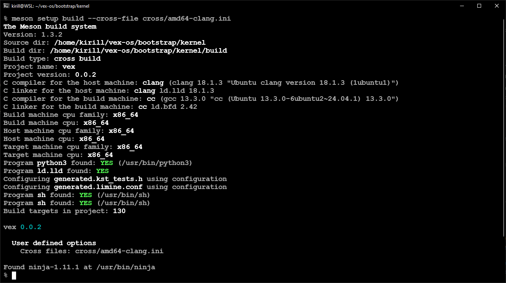
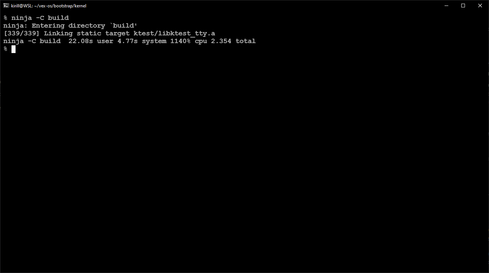
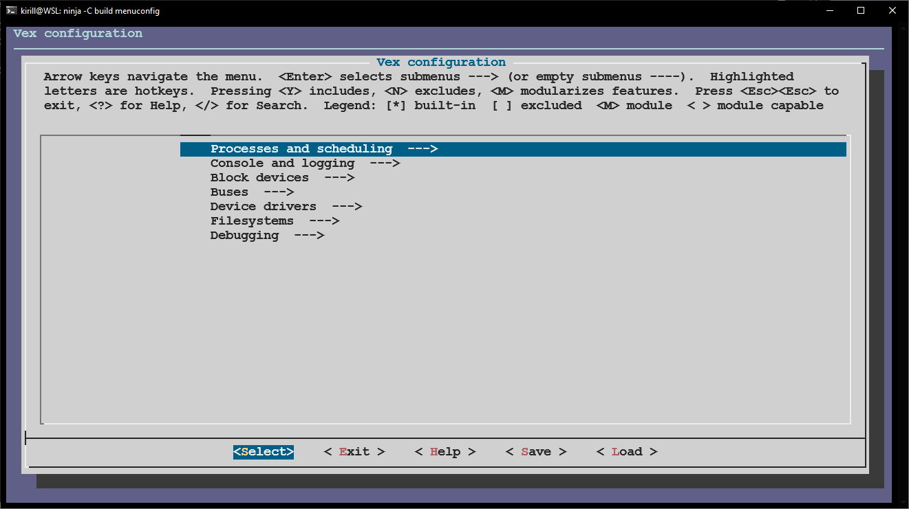
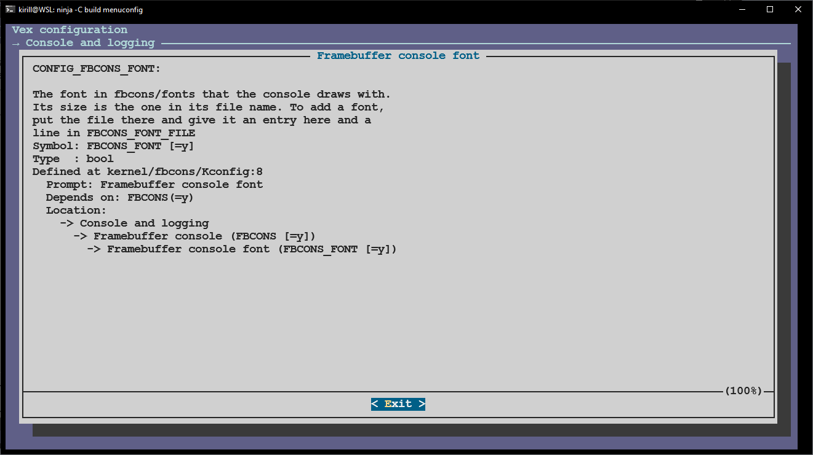
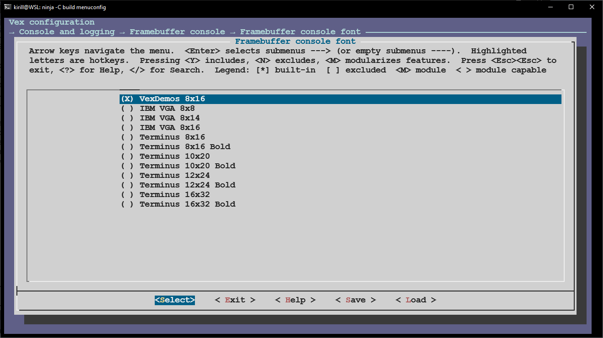

# Build

Meson and Ninja build Vex. Every build is a cross build: the kernel
runs on amd64, and the host that builds it is some other machine. Meson stops
with an error when the setup has no cross file.

## Requirements

| Tool | Use |
|---|---|
| Meson 1.3.2 or later, Ninja | Configure and build |
| Python 3 | Read the Kconfig tree |
| Clang and LLD | Compile and link the kernel |
| A GNU-compatible `ld` | The final link |
| `sh` | The image and QEMU scripts |
| `sfdisk`, `mkfs.fat`, mtools, `mke2fs` | The test image |
| QEMU and OVMF | Run the kernel |

- Kconfiglib sits in `contrib/kconfiglib`. Python needs no extra packages.
- The build runs on Linux and on WSL. Native Windows is not supported.
- The test image tools and QEMU are only needed for
  [the test image](ktest.md) and for [running](run.md).

### Compilers

`cross/amd64-clang.ini` is the tested cross file. It uses `clang`, `ld.lld`
and `llvm-ar`, and it adds `-Wdocumentation`, so a broken `///` block fails
the build.

`cross/amd64-gcc.ini` uses an `x86_64-elf-*` toolchain. The
`vex-os/bootstrap` repository builds the kernel with it. Do not expect it to
work without that toolchain.

The kernel link does not use the linker from the cross file. It calls `ld`
from `PATH` directly, because Clang has no bare-metal driver for amd64.
Install GNU ld, or make `ld` name LLD. Both understand the link script.

## Configure

```sh
meson setup build --cross-file cross/amd64-clang.ini
```



*The screenshot comes from a kernel checkout inside the `vex-os/bootstrap`
repository, so its paths differ from yours.*

The output names the cross file, the compiler, the host and the target, the
generated files and the number of build targets. Meson reads `x86_64` from the
cross file and the build maps it to the `amd64` arch name.

The setup options are:

| Option | Meaning |
|---|---|
| `-Ddefconfig=<name>` | File in `configs/` that seeds `.config`. The default is `<arch>_defconfig` |
| `-Dktest=false` | Do not build the test image, the runner or the test programs |

To change an option after the setup, run `meson configure build -D<option>`
and then `ninja -C build`. Meson reconfigures on its own when a Kconfig file
changes.

## Build

```sh
ninja -C build
```



The build writes the kernel to `build/kernel/vexsys.elf`. With the test layer
enabled, the same command also builds the test programs.

| Target | Output |
|---|---|
| `ninja -C build` | `build/kernel/vexsys.elf` |
| `ninja -C build ktest-image` | `build/ktest/vexsys.boot.img` |
| `ninja -C build ktest-run` | Builds the image and boots it in QEMU |

The project sets `werror=true` and `warning_level=2`. A new warning fails the
build. For a local experiment only, add `-Dwerror=false` at setup.

## Configuration

Vex uses Kconfig, the configuration language that Linux uses. Kconfiglib is
vendored, so the configuration works without a Linux source tree.

### The model

The configuration is a tree of symbols. Each symbol has a type, a prompt, a
default and help text. The types are:

- `bool`, on or off
- `int` and `hex`, a number with an optional range
- `string`, free text
- `choice`, one symbol out of a group

A symbol can depend on another symbol through `depends on`. It then exists
only when that symbol is set. `select` forces another symbol on. This is how
`ARCH_AMD64` selects `ARCH_HAS_SMP`: the arch code offers SMP, and the
generic code tests for it.

Each directory has its own `Kconfig` file. The file holds the help text for
its options, so the description of an option sits next to the code that reads
it. The menu shows that text.

### The menu

```sh
ninja -C build menuconfig
```



The top level groups the options by subsystem. The entries follow
`kernel/Kconfig`, which sources one file per directory.



The help pane shows the text from the `Kconfig` file, then the type, the
default, the dependencies and the location in the tree.



A `choice` offers one value out of a list. The framebuffer font is one: the
list holds every font that `kernel/fbcons/Kconfig` declares, and the chosen
symbol names the file that the build converts.

### The config file

The configuration lives in `build/.config`. At configure time,
`scripts/kconfig/sync_config.py` does this:

- If `build/.config` exists, load it.
- If it does not exist, copy the defconfig into it.

The defconfig holds only the values that differ from the Kconfig defaults.
`configs/amd64_defconfig` is empty for that reason: every option is at its
default.

**The defconfig is a seed, not a mirror.** A change to the defconfig does
nothing to a build tree that already has a `.config`. Delete `build/.config`,
or run `ninja -C build defconfig`, to seed the tree again.

To change the defaults, run `ninja -C build savedefconfig` and copy
`build/defconfig` over `configs/<arch>_defconfig`.

### In the code

At build time, `scripts/kconfig/gen_config_h.py` turns `.config` into
`build/kernel/generated.config.h`:

- an enabled `bool` becomes `#define CONFIG_X 1`.
- a disabled `bool` has no definition.
- an `int`, `hex` or `string` becomes a macro with its value.

The build force-includes that header into every kernel translation unit with
`-include`. `CONFIG_*` macros are always visible, so never include the header.

`meson.build` gates an optional file:

```meson
if kconfig.get('CONFIG_EXT2', 'n') == 'y'
    subdir('ext2')
endif
```

Do not add an `#ifdef` around a whole file. The gate belongs in Meson, so the
file does not build at all when its option is off.

## How the build works

```
Kconfig tree -> build/.config -> generated.config.h
                                 (force-included in every unit)
kernel/meson.build
  +-- one archive for each top directory of kernel/
  +-- ld --whole-archive -T kernel/arch/amd64/kernel.ld
  +-- build/kernel/vexsys.elf
```

The archives keep the top directories independent. Each `meson.build` only
appends its files to `kernel_sources`. The table in `kernel/meson.build` names
the directories and the log tag of each one. A new top directory needs a row
in that table.

[The source map](source-map.md) explains the directories and the archives.

## Traps

- A change to the defconfig does nothing while `build/.config` exists.
- `-Ddefconfig` takes a file name inside `configs/`, not a path.
- The generated config header is force-included. Do not include it.
- An optional file needs a Kconfig symbol and a Meson gate, not an `#ifdef`.
- A top directory without a `kernel_subsystems` row is not built and does not
  exist as an archive.
