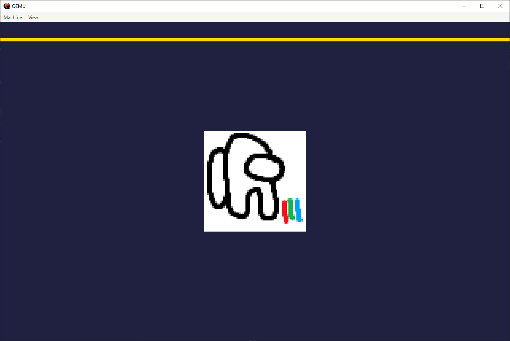
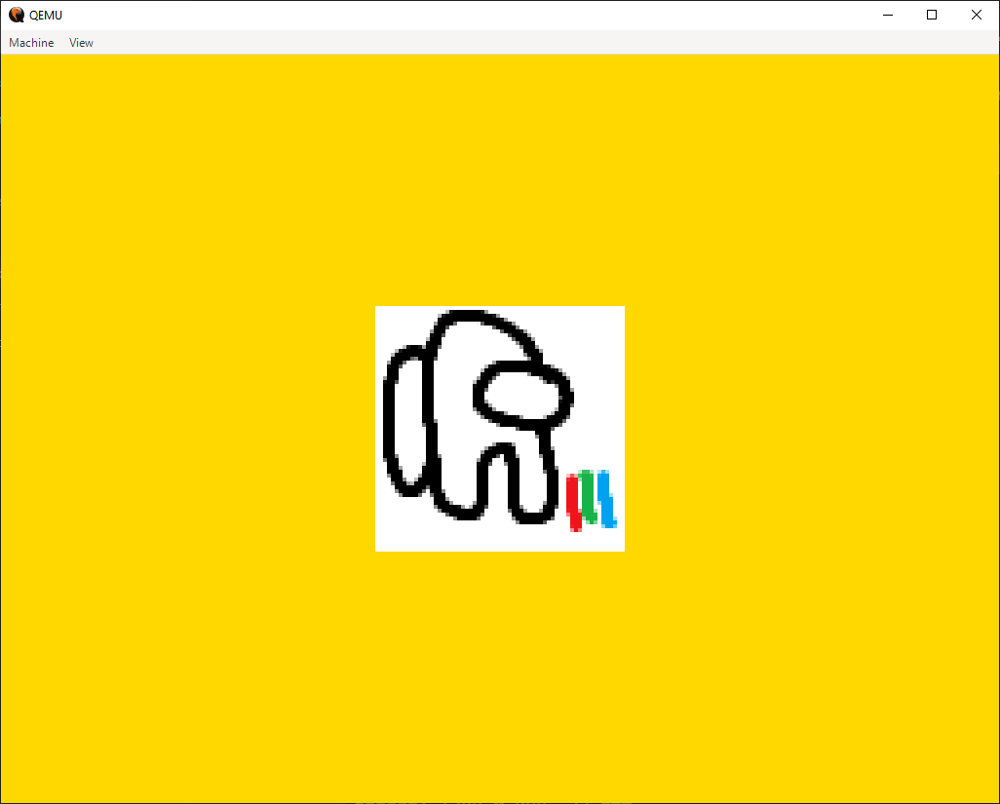

# The test image and kst

`ktest/` is the kernel's own test image. It holds the Limine config, the
script that makes the disk, the test runner `kst` and the test programs that
`kst` runs. It is not the userspace: it exists to check that the kernel
behaves as it should.

The image boots `kst` as init. `kst` runs on the kernel as a normal process,
with the full capability set, and forks the tests.

## The image

The image is a 40 MiB GPT disk with three partitions:

| Partition | Sectors | Filesystem | Contents |
|---|---|---|---|
| ESP | 2048 to 18432 | FAT16 | `BOOTX64.EFI`, `limine.conf`, `vexsys.elf` |
| DATA | 18432 to 71680 | ext2 | `kst.elf`, `kst/*.elf`, the test tree |
| FAT | 71680 to 79872 | FAT16 | `DIR/`, one long file name |

The kernel names them `ada0n1p1`, `ada0n1p2` and `ada0n1p3`. Limine boots from
the ESP and the kernel mounts DATA at `/`. The FAT tests write to `ada0n1p3`.

The ext2 partition holds a tree that the tests need:

- `hello.txt`, `dir/nested/file.txt`, a symlink and a long symlink
- `empty/` and `many/`, the second with 200 long file names
- `big.bin`, 5 MiB, which reaches the double indirect block
- `sparse.bin`, a file with a hole
- `dev/` and `tmp/`, the mount points that `kst` and the tests use
- `kst.elf` at the root and one ELF per test under `kst/`

`ktest/mkimage.sh` makes the disk. The offsets live in `ktest/meson.build` and
in the script.

## Build and boot

```sh
ninja -C build ktest-image    # build/ktest/vexsys.boot.img
ninja -C build ktest-run      # build the image and boot it
```

The image needs `sfdisk`, `mkfs.fat`, mtools (`mmd`, `mcopy`) and `mke2fs`.
`ninja -C build ktest-run` runs `ktest/qemu.amd64.sh`, which starts QEMU with
OVMF and attaches the image.

`-Dktest=false` at configure time excludes the whole directory, so the two
targets disappear.

`ktest/limine.conf.in` is a template. The build fills in the port names:

| Port | Name | QEMU | Device path |
|---|---|---|---|
| Shell | `serial1` | COM1, stdio | `acpi:PCI0/pci:0000:00:1f.0/isa:3f8` |
| Log | `serial2` | COM2, file | `acpi:PCI0/pci:0000:00:1f.0/isa:2f8` |

The kernel command line is:

```
root=ada0n1p2 init=/kst.elf
unit=serial1,acpi:PCI0/pci:0000:00:1f.0/isa:3f8
unit=serial2,acpi:PCI0/pci:0000:00:1f.0/isa:2f8
serial=serial1,tty1337
console=serial1,115200 console=serial2,115200 console=fbd0
```

The config pins the ports with `unit=`. The probe order does not decide the
names.
`serial1` becomes the tty `tty1337`, and `kst` opens it. The kernel writes its
log to both serial ports and to the framebuffer console.

## kst

`kst` is init. It does what an init must do:

1. Make `/dev` and mount devfs.
2. Open `/dev/tty1337`.
3. Make it the controlling terminal with `TIOCSCTTY`.
4. Duplicate it onto file descriptors 0, 1 and 2.
5. Set the line discipline for a serial terminal.
6. Clear the screen and print the banner.

Before step 2 it writes to kplog, because it has no output yet. If the
terminal does not open, the message says so and names `serial=` on the command
line.

The commands are:

| Command | Effect |
|---|---|
| `help` | Print the command list |
| `list` | Print the tests in the order that `all` runs them |
| `run <test\|path>...` | Run tests by name, or programs by path |
| `all` | Run every test |
| `clear` | Clear the screen |
| `exit` | Leave, which panics the kernel because init died |

`run` forks, execs `/kst/<name>.elf` and waits. The child leads a process
group and owns the terminal. Ctrl-C then reaches the test, not the runner.
The runner prints `[ OK ]` or `[FAIL]` with a timestamp for each program, and
the reason for a failure: an exit status, a signal or a failed `waitpid`.



*A test that draws on the framebuffer: the `fbtest` logo.*



*The same test fills the screen. The framebuffer test runs last, because it
takes the machine over.*

## The QEMU wrapper

`ktest/qemu.amd64.sh` connects the shell port to stdio and the log port to
`kernel.log`. It switches the terminal to raw mode: the terminal would
otherwise echo each line and the guest would echo it again. Under WSL it
calls `qemu-system-x86_64.exe` and converts the paths.

| Argument | Effect |
|---|---|
| `slow` | Enable `-icount`. One instruction takes 1 ns |
| `slow=N` | One instruction takes 2^N ns. A bigger N is slower |
| `verbose` | Add `-d cpu_reset,int -no-reboot -no-shutdown` |
| `N` | Log to `qemu_N.log` instead of `qemu.log` |
| `nocpurng` | Hide RDRAND and RDSEED from the guest |

The script removes `qemu.log` and `kernel.log` at the start. The kernel log is
also on the framebuffer console, which survives a crash that loses the file.

Ctrl-A X quits QEMU. Ctrl-A C opens the QEMU monitor.

## After a run

The tests write to the ext2 partition. Check it after a run:

```sh
e2fsck -fn "build/ktest/vexsys.boot.img?offset=$((18432 * 512))"
```

The offset is the first sector of the DATA partition in bytes. `e2fsck`
accepts the `?offset=` suffix and reads the filesystem inside the image.

## Tests

Each test is a separate ELF from `ktest/test.<name>.c`. `ktest/meson.build`
lists them in `ktest_programs`, in the order that `all` runs them. A test
returns 0 for success and checks with `ktest_expect`.

[Writing a test](../development/testing.md) explains the test ABI.
