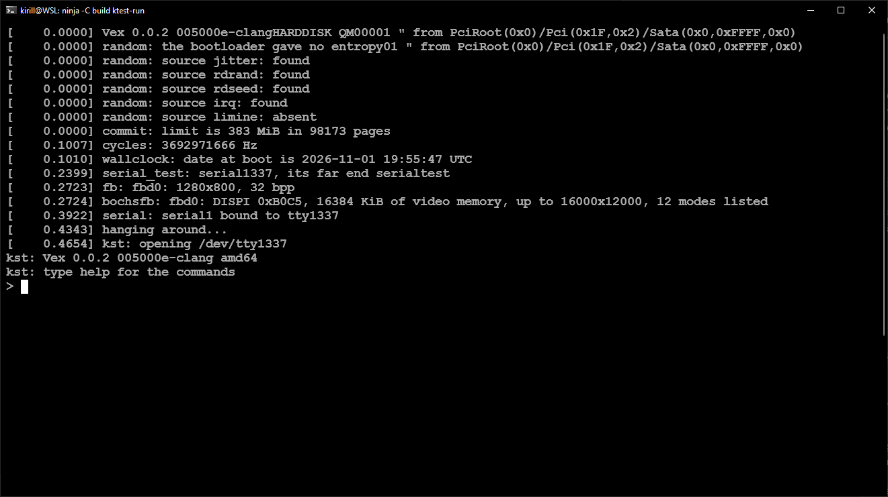
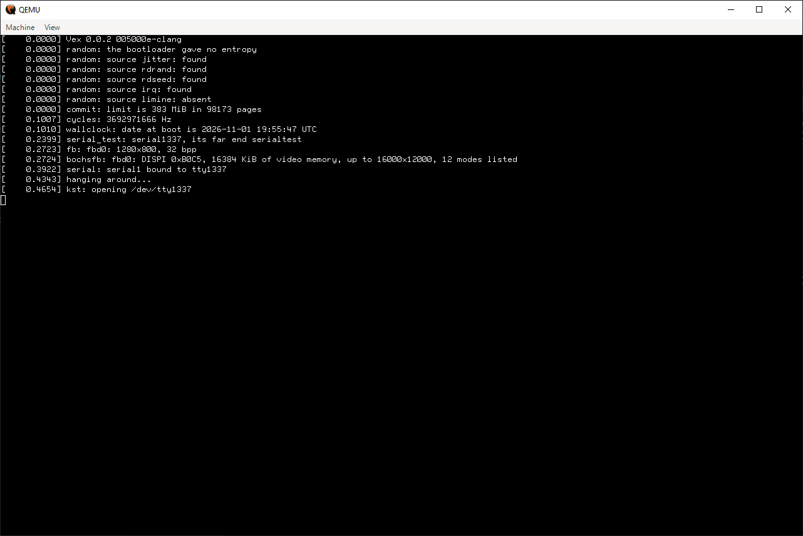

# Run

The Vex repository has no userspace. The kernel loads one program from the
root filesystem and gives control to it. This page makes a disk that boots
such a program, and explains what that program must do.

The test image boots `kst`, a test runner. It is one userspace, and
[the next page](ktest.md) covers it. This page covers the general case.

## What a boot needs

Three parts:

- Limine, the bootloader, as an EFI executable
- `vexsys.elf`, the kernel
- a block device with a root filesystem and an init program on it

The kernel receives one command line from Limine. It names the root device,
the init path, the consoles and the log level.

## The first process

In a Unix-like system, process 1 is the first user process. The kernel does
not start a shell or a service manager. It starts one program, and that
program starts everything else. Process 1 adopts the orphans and reaps the
zombies. Linux, the BSDs and Vex all work this way.

Vex does this in `kmain()`:

1. Run the BSP initcalls.
2. Mount the device from `root=` at `/`.
3. Open the program from `init=`, or `CONFIG_DEFAULT_INIT`.
4. Load it and spawn it.
5. Enable interrupts and idle.

See `kernel/init/kmain.c`.

In the test image, `kst` is process 1. A test runner needs the rights and the
duties of init: it forks the tests, waits for them and owns the terminal. When
it exits, the kernel panics, because init must not die.

### The contract

| Property | Value |
|---|---|
| Path | `init=` or `CONFIG_DEFAULT_INIT`, resolved in the root filesystem |
| Argument vector | `{ path, NULL }` |
| Environment | Empty |
| File descriptors | None open |
| Credentials | uid 0 and the full capability set |
| Executable | ELF64, static, `ET_EXEC` |
| Stack | 128 KiB mapped at exec, grows to `RLIMIT_STACK` |
| Working directory | `/` |

The consequences:

- The program must open its own console. The kernel gives it no standard
  input, output or error.
- The kernel mounts only the root filesystem. If init wants `/dev`, it makes
  the directory and mounts devfs. If it wants `/tmp`, it mounts tmpfs.
- The executable must not have `PT_INTERP` or `PT_DYNAMIC`. The loader returns
  `ENOSYS` for both, so there is no `ld.so` and no shared library yet.
- Nothing reaps for init. It must wait for its own children.
- `exit` from init is fatal to the machine. Shutdown is a separate system
  call.

The working example is `kst` itself: it mounts devfs, opens `/dev/tty1337`,
makes it the controlling terminal and duplicates it onto 0, 1 and 2. See
`ktest/kst.c`.

## Make a disk

The test image has a GPT disk with an EFI system partition, an ext2 root and a
FAT partition for the FAT tests. A userspace image needs the first two.

The commands below make a 40 MiB disk with the same layout. The kernel and the
bootloader go on the ESP, the root filesystem in the second partition.

```sh
# 1. An empty disk with an ESP and a root partition
dd if=/dev/zero of=vex.img bs=1M count=40

sfdisk --quiet --force vex.img <<'EOF'
label: gpt
start=2048,size=16384,type=C12A7328-F81F-11D2-BA4B-00A0C93EC93B,name=ESP
start=18432,size=53248,type=0FC63DAF-8483-4772-8E79-3D69D8477DE4,name=ROOT
EOF

# 2. The filesystems
mkfs.fat -F16 -s 1 --offset 2048 vex.img $((16384 / 2))
mke2fs -q -F -t ext2 -b 4096 \
    -E offset=$((18432 * 512)),root_owner=0:0 \
    -d root vex.img $((53248 / 2))k

# 3. Limine, the kernel and the config on the ESP
esp="vex.img@@2048s"
mmd -i "$esp" ::/EFI ::/EFI/BOOT
mcopy -i "$esp" contrib/limine/BOOTX64.EFI ::/EFI/BOOT/BOOTX64.EFI
mcopy -i "$esp" build/kernel/vexsys.elf ::/vexsys.elf
mcopy -i "$esp" limine.conf ::/limine.conf
```

The `root/` directory holds the root filesystem. It needs an `init` program
and the files that the program opens:

```
root/
└── init
```

`mke2fs -d` copies the tree, and `root_owner=0:0` makes root own it. The
partition sizes come from `ktest/mkimage.sh`. Any size works if the filesystem
fits.

The `@@2048s` suffix is mtools syntax for an offset in sectors. `mmd` and
`mcopy` write into the FAT filesystem inside the image without a loop device.

## The Limine config

Limine reads `/limine.conf` from the ESP. On EFI it also tries the directory
of its own executable, then `/boot/limine/limine.conf`, `/boot/limine.conf`
and `/limine/limine.conf`. See the
[Limine configuration reference](https://github.com/limine-bootloader/limine/blob/trunk/CONFIG.md).

```
timeout: 0
verbose: yes

/Vex
    comment: Vex
    protocol: limine
    path: boot():/vexsys.elf
    cmdline: root=ada0n1p2 init=/init console=serial1,115200 serial=serial1,tty0
    kaslr: yes
```

- `timeout: 0` boots the entry at once, with no menu.
- `path` is `<resource>(<argument>):/<file>`. `boot()` means the partition
  that holds this config file, which is the ESP.
- `protocol: limine` is the Limine protocol, which the kernel uses for its
  requests.
- `cmdline` is the kernel command line. See below.
- `kaslr: yes` asks Limine to place the kernel at a random base. The kernel
  asks Limine for its base address.

The config is a set of menu entries and options. A line that starts with `/`
opens an entry, and the options after it belong to that entry. Lines that
start with `#` are comments.

## Boot it

```sh
qemu-system-x86_64 \
    -bios contrib/edk2/RELEASEX64_OVMF.fd \
    -machine type=q35 \
    -drive format=raw,file=vex.img \
    -serial mon:stdio \
    -vga std \
    -m 512M \
    -smp 4
```

- `-bios` loads the OVMF firmware. The repository vendors it.
- `-drive` attaches the disk as an ATA disk. The kernel names it `ada0`.
- `-serial mon:stdio` connects the first serial port to the terminal. Ctrl-A X
  quits QEMU, and Ctrl-A C opens its monitor.
- `-vga std` gives the kernel a framebuffer.

Under WSL, call `qemu-system-x86_64.exe` and convert the paths with
`wslpath -a -w`. `ktest/qemu.amd64.sh` does this for the test image.

The kernel logs to the console. When the init opens its terminal, the init
writes there too.



*The example is the test image, because `kst` is the only init that exists
today. The kernel log and the init share the serial port.*

## The command line

The kernel reads the command line as a list of `key=value` words. The keys
that matter for a boot are:

| Option | Meaning |
|---|---|
| `root=<device>` | Block device to mount at `/`. A name such as `ada0n1p2` |
| `init=<path>` | First process. Defaults to `CONFIG_DEFAULT_INIT` |
| `console=<name>[,<options>]` | Register a kernel console |
| `serial=<port>,<consumer>[<index>]` | Bind a serial port to a tty or a test device |
| `unit=<name>,<device path>` | Pin a device name to a node path |
| `loglevel=<level>` | Lowest level that the kernel logs |

The consoles are `serial<N>` for a serial port and `fbd0` for the
framebuffer. The kernel passes the options to the console. A serial console
takes its baud rate. A key can repeat: one `console=` per console, one `unit=`
per device.

Device names are `<prefix><unit>n<index>p<partition>`. In `ada0n1p2`, `ada` is
the ATA class, `0` is the controller, `1` is the port or connector and `2` is
the partition. The probe order decides the numbers. `unit=` pins a number to a
node path, as `/dev/hwtree` shows it. The test image pins its serial ports for
this reason.

`loglevel` takes `verbose`, `inform`, `notice`, `warning`, `error`,
`critical` or `alert`. The default shows the important messages.

## Consoles

The kernel can draw its log in two places at once:

- **Serial.** `console=serial1,115200` sends the log to the first serial port.
  QEMU connects that port to the terminal with `-serial mon:stdio`.
- **Framebuffer.** `console=fbd0` draws the log on the framebuffer that Limine
  set up. This is the `fbcons` backend, and it needs `CONFIG_FBCONS`.



*The same boot on `fbd0`. The framebuffer console shows the kernel log only.
The init writes to its own terminal.*

Both consoles can be active. The test image sets both, so a failure to open
the serial port still leaves the log on the screen.

## Limits

- The init is static ELF64. Dynamic linking needs the loader support that does
  not exist yet.
- The kernel does not ship a C library. The system call numbers and the user
  ABI are in `kernel/include/usr/vex/`.
- The kernel mounts only `root=`. Everything else is the init's job.
- An init that exits panics the kernel. Use the shutdown system call to stop
  the machine.
